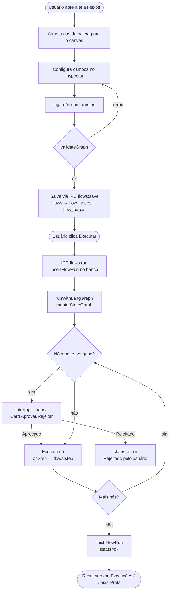

# Fluxos — Documentação

Documentação completa do sistema de Fluxos do **CH BOTS**. Fluxos são automações visuais que conectam nós de processamento (agentes, ferramentas, condições) em um grafo executado pelo runner LangGraph.

---

## Índice

| Documento | O que cobre |
|-----------|-------------|
| [tela.md](tela.md) | Layout da tela (paleta, canvas, painéis, atalhos, modo foco) |
| [nos.md](nos.md) | Todos os tipos de nó: campos, entradas, saídas, exemplos |
| [conexoes.md](conexoes.md) | Como ligar nós, arestas condicionais, regras de validação |
| [execucao.md](execucao.md) | Botão Executar, runner LangGraph, estado, limites, parar |
| [aprovacao.md](aprovacao.md) | Nós perigosos, interrupt(), card Aprovar/Rejeitar |
| [persistencia.md](persistencia.md) | Tabelas SQLite, retomada após fechar, Caixa-Preta |
| [ipc-api.md](ipc-api.md) | IPC Electron e rotas HTTP da porta 3111 |
| [exemplos.md](exemplos.md) | 3 fluxos completos passo a passo |
| [problemas.md](problemas.md) | Erros comuns e como resolver |

---

## Visão geral

A tela Fluxos permite criar automações visuais compostas por até **10 nós** conectados. Os tipos disponíveis são:

| Tipo | Label | Perigoso? |
|------|-------|-----------|
| `trigger` | Gatilho | não |
| `news` | Buscar notícias | não |
| `promptgen` | Gerador de Prompt | não |
| `agent` | Agente | não |
| `condition` | Condição | não |
| `output` | Saída | **sim** (save_md) |
| `memory` | Memória | não |
| `delegate` | Delegar | **sim** |
| `mcp-tool` | Ferramenta MCP | **sim** |

Cada execução é registrada em `flow_runs` e `flow_run_steps`. Nós perigosos pausam a execução e exibem um card de aprovação antes de agir.

---

## Como um fluxo é desenhado, salvo e executado

---

## Arquivos-chave

| Arquivo | Papel |
|---------|-------|
| `src/shared/flows.ts` | Tipos, validação, labels — sem dependências externas |
| `src/main/flows/langgraphRunner.ts` | Runner LangGraph: StateGraph, interrupt, limites |
| `src/main/flows/runner.ts` | `FlowRunner`: IPC → runner → banco |
| `src/main/flows/engine.ts` | `EngineActions`: ações com efeito colateral |
| `src/main/db/repos/flows.ts` | CRUD SQLite de flows, runs e steps |
| `src/main/flows/langgraphCheckpointer.ts` | Checkpointer SQLite para retomada |
| `src/renderer/src/flows/FlowEditor.tsx` | Editor visual (React Flow) |
| `src/renderer/src/flows/Inspector.tsx` | Formulários de propriedades dos nós |
| `src/main/ipc.ts` | Handlers IPC `flows:*` |
| `src/main/api.ts` | Rotas HTTP `/api/flows*` porta 3111 |
| `src/main/db/migrations.ts` | DDL das tabelas de fluxos |

---

## Última atualização

Data: 2026-10-26  Commit: 19a816b
